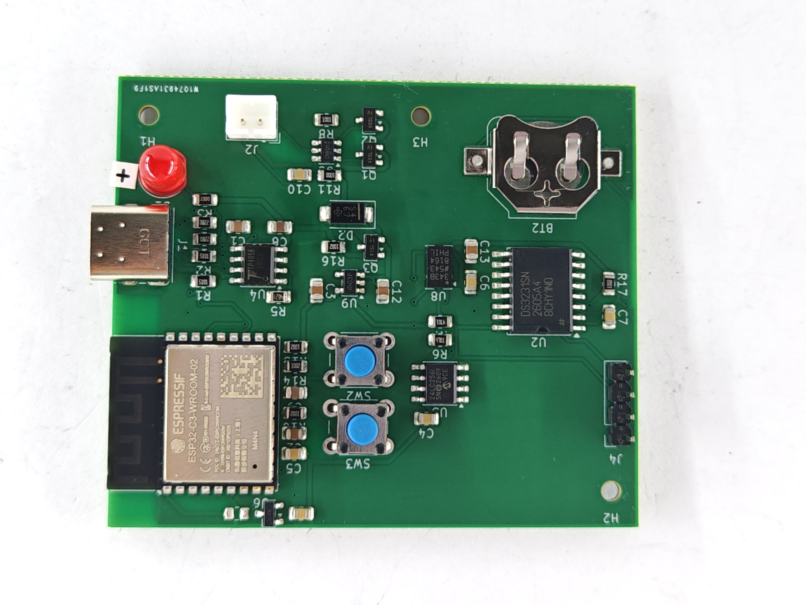

# Medication Bottle Monitor (Rev 2 board)

A small, low power board that sits under a medication container and logs when it is handled.
Built around an ESP32 C3 with a Hall effect sensor, an accelerometer and a real time clock.

**Status:** Rev 2 boards received, bring up and testing in progress.

## Hardware features
- ESP32 C3 (WROOM 02) with Wi-Fi and Bluetooth LE
- Native USB, so programming needs no USB to serial chip
- USB C charging with a TP4056 and DW01A battery protection
- Load sharing: runs from USB while the lithium battery charges
- 3.3 V LDO (AP2112K)
- ADXL343 3 axis accelerometer
- DRV5032FA low power Hall sensor
- DS3231 real time clock with CR1220 backup
- 24LC256 EEPROM for storing events
- SSD1306 OLED header
- Deep sleep, with wake from the Hall sensor, accelerometer or clock alarm

## Board
2 layer, about 63 x 54 mm, 3 mounting holes. KiCad 10 project in `hardware/kicad`, Gerbers in `hardware/gerbers`, BOM in `hardware/bom`, schematic in `docs`.

## Flash the logger firmware
1. Install the ESP32 board package in Arduino IDE and pick "ESP32C3 Dev Module".
2. Set "USB CDC On Boot" to Enabled.
3. Hold BOOT, tap RESET, then upload `firmware/logger.ino`.
4. Run `python firmware/logger.py <port>` to save a CSV of accelerometer and Hall sensor readings.

`firmware/logger.ino` has not been tested on hardware yet.

Patent pending.
